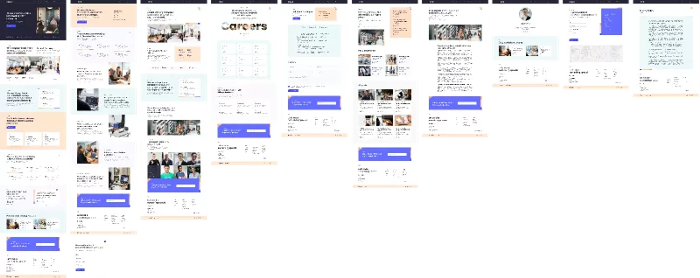

# Finsweet Agency — High-Impact Digital Solutions & IT Agency Platform (30-Amaliy Ish)

Figma dizaynining yuqori aniqlikdagi (**Pixel-Perfect**) to'liq, zamonaviy, interaktiv va to'liq moslashuvchan (fully responsive) raqamli agentlik, IT yechimlar va dasturiy ta'minot konsalting platformasi: **Finsweet Agency — Client-First Design System (node-id: 1:1755)**.

[-F24E1E?logo=figma&logoColor=white)](https://www.figma.com/file/JF1wS8Bw0GQUovvsPrnXSd/Finsweet-Agency?type=design&node-id=1%3A1755&mode=design&t=oGzGS6UrumHMIzzL-1)
[](https://developer.mozilla.org/en-US/docs/Web/HTML)
[](https://developer.mozilla.org/en-US/docs/Web/CSS)
[](https://developer.mozilla.org/en-US/docs/Web/JavaScript)
[](https://developer.mozilla.org/en-US/docs/Learn/CSS/CSS_layout/Responsive_Design)
[](https://vercel.com/)

---

## 📸 Figma Dizayn Ko'rinishi (Master Canvas)



---

## 📌 Loyiha Haqida

Ushbu loyiha Figma platformasidagi mashhur **Finsweet Agency (High-Impact Digital Solutions & Technology Platform)** dizaynining to'liq ekotizimi va dizayn tokenlari (node-id: `1:1755`) asosida 100% aniqlik bilan ishlab chiqildi. Loyiha bizneslarni raqamlashtirish, veb va mobil mahsulotlarni loyihalash, IT konsalting, xizmatlar vitrinasi, kompaniya madaniyati va jamoasi, ochiq bo'sh ish o'rinlari (Careers Portal), texnologik blog hamda mijozlar bilan tezkor bog'lanish tizimini o'z ichiga olgan mukammal ko'p sahifali veb-platformadir.

- **Figma Manzili**: [Finsweet Agency — node-id: 1:1755](https://www.figma.com/file/JF1wS8Bw0GQUovvsPrnXSd/Finsweet-Agency?type=design&node-id=1%3A1755&mode=design&t=oGzGS6UrumHMIzzL-1)
- **Topshiriq**: 30-Amaliy Ish
- **GitHub Repozitoriyasi**: [https://github.com/soxibs48-eng/amaliy30](https://github.com/soxibs48-eng/amaliy30)

---

## ✨ Asosiy Sahifalar va Imkoniyatlar

Loyiha Figma dizaynidagi barcha 9 ta asosiy artboard va qo'shimcha ichki CMS shablon sahifalarini to'liq qamrab olgan:

### 1. 🏠 Asosiy Bosh Sahifa (`index.html`):
- **Header & Navbar**: Elegant `{Finsweet` brend logotipi, sahifalar menyusi (Home, Services, Company, Careers, Blog, Contact us), "Clone project" harakat tugmasi hamda mobil qurilmalar uchun moslashuvchan interaktiv gamburger menyu.
- **Hero Banner**: *"Prosper with our high-impact solutions"* sarlavhasi, IT agentlik salohiyati, hamkorlik qilish taklifi va loyiha muhokamasi tugmasi.
- **Hamkor Kompaniyalar**: Fortune 500 va xalqaro brendlarning ishonchli logotiplari qatori.
- **Biz Haqimizda (About Split)**: *"We're a team of creatives, thinkers and makers"* — kompaniya tarixi, jamoaviy uchrashuvlar galereyasi va asosiy yutuqlar.
- **Ish Jarayoni (Our Process)**: Rejalashtirish, tadqiqot, dizayn va dasturlash bo'yicha 4 bosqichli metodologiya (`01`, `02`, `03`, `04`).
- **Xizmatlar Vitrinasi (Services Cards)**: Biznes konsalting, UI/UX dizayn, veb dasturlash va texnik yordam kartalari.
- **Mijozlar Fikrlari (Interactive Testimonial Carousel)**: Mijozlarning ijobiy tavsiyanomalari, kompaniya logotipi, muallif ma'lumotlari, chap/o'ng boshqaruv o'qlari va interaktiv navigatsiya nuqtalari (dots) bilan jihozlangan slayd karusel.
- **So'nggi Blog Maqolalari (Latest News)**: Eng dolzarb dizayn va dasturlash tendensiyalari prevyusi.
- **Interaktiv Aloqa va Newsletter**: Tezkor bog'lanish formasi, email orqali axborot byulleteniga a'zo bo'lish hamda chiroyli tasdiqlovchi Toast bildirishnomasi.
- **Footer**: To'liq rekvizitlar, manzil, ijtimoiy tarmoqlar (Facebook, Twitter, Instagram, LinkedIn), xizmatlar ro'yxati va mualliflik huquqi.

---

### 2. ⚡ Xizmatlar Sahifasi (`services.html`):
- Biznes tahlili, texnologik auditi va konsalting.
- Veb-saytlar va veb-ilovalarni arxitekturasi va dasturlash.
- Raqamli brending va mahsulot UI/UX dizayni.
- Dasturiy ta'minotni qo'llab-quvvatlash va kengaytirish (Maintenance & Support).

---

### 3. 🏢 Kompaniya va Jamoa (`company.html`):
- Kompaniyaning missiyasi, qarashlari va korporativ qadriyatlari.
- Raqamlardagi yutuqlar: 15+ xalqaro mukofot, 120+ muvaffaqiyatli loyiha, 50+ yuqori toifali mutaxassislar.
- Ofis ichki muhiti, ish jarayonlari va zamonaviy jamoa a'zolari fotosuratlari.
- Boshqaruv kengashi va loyiha rahbarlari profillari.

---

### 4. 💼 Karyera Portali (`careers.html`):
- Karyera imkoniyatlari va qulay ish sharoitlari (masofaviy ishlash, rivojlanish byudjeti, sog'liqni saqlash).
- Ochiq vakansiyalar ro'yxati: Full Stack Developer, Golang Developer, Product Designer, HR Manager, QA Tester va boshqalar.
- Har bir lavozim bo'yicha joylashuv (Remote / On-site) va ish tajribasi filtrlari.

---

### 5. 📑 Vakansiya Tafsilotlari (`career-single.html`):
- Ochiq lavozimning to'liq tavsifi va mas'uliyat doirasi.
- **Interaktiv Tab Tizimi (`Tabs Engine`)**:
  - `Details`: Ish haqida umumiy ma'lumotlar va bo'lim vazifalari.
  - `Requirements`: Nomzodga qo'yiladigan asosiy texnik talablar va ko'nikmalar.
  - `Responsibilities`: Kundalik ish faoliyati va mas'uliyatlar.
- Ariza topshirish formasi va tezkor rezyume yuborish imkoniyati.

---

### 6. 📰 Blog va Yangiliklar (`blog.html`):
- Bosh maqola: *"Transform your idea into reality with Finsweet"*.
- Barcha yangi maqolalar gridi, nashr sanalari, o'qish vaqti va muallif ma'lumotlari.
- Kategoriya teglari va saralash.

---

### 7. 📖 Maqola Tafsilotlari (`blog-single.html`):
- Katta formatdagi sifatli sarlavha surati va tipografik jihatdan qulay o'qiluvchi matn bloklari.
- Muallif iqtiboslari, ko'rgazmali illyustratsiyalar.
- Maqola muallifi haqida qisqacha ma'lumot va ijtimoiy tarmoq havolalari.
- Mavzuga oid boshqa tavsiya etiluvchi maqolalar bloki.

---

### 8. 👤 Jamoa A'zosi Profili (`team-single.html`):
- Mutaxassisning to'liq profili, lavozimi va tajribasi.
- Bio va shaxsiy loyihalari haqida ma'lumotlar.
- Ushbu mutaxassis qalamiga mansub maqolalar va mualliflik ishlari.

---

### 9. ✉️ Bog'lanish Sahifasi (`contact.html`):
- Foydalanuvchilar va buyurtmachilar uchun qulay kontakt shakli (Ism, Email, Xabar).
- Kompaniya ofis manzili, telefon raqami va elektron pochtasi.
- Ish vaqtlari va xarita ko'rinishi.

---

### 10. 🔒 Maxfiylik Siyosati (`privacy-policy.html`):
- Foydalanuvchilar shaxsiy ma'lumotlarini himoya qilish siyosati.
- Xalqaro xavfsizlik va GDPR standartlariga to'liq muvofiqlik.

---

### 11. 🚫 404 Xatolik Sahifasi (`404.html`):
- Sahifa topilmagan holatlar uchun brend ranglaridagi maxsus dizayn va bosh sahifaga xavfsiz qaytish tugmasi.

---

## 🛠 Texnologik Stek

- **HTML5**: Semantik, qidiruv tizimlari (SEO) va qulaylik (Accessibility) talablariga mos belgilash.
- **CSS3 & Design Tokens**: Finsweet Client-First metodologiyasiga asoslangan, tartibli va toza o'lchov birliklari (`rem`), global ranglar palitrasi va animatsiyalar.
- **Vanilla JavaScript (ES6+)**: Hech qanday tashqi og'ir kutubxonalarsiz (jQuery-free) 100% mustaqil, tezyurar interaktiv skriptlar:
  - Mobil menyu (Hamburger Drawer)
  - Interaktiv Testimonial Karusel (Slider & Swipe)
  - Ko'p bosqichli Tablar mexanizmi (Career Tabs)
  - Shakllarni tekshirish (Form validation) va zamonaviy Toast bildirishnomalari
  - "Yuqoriga qaytish" (Back to Top) silliq skroll tugmasi.
- **Google Fonts**: `Poppins` font oilasining barcha garnituralari (100–900).
- **Vercel**: `vercel.json` orqali toza URL manzillari (Clean URLs) va bir zumda deploy qilishga tayyor konfiguratsiya.

---

## 📂 Loyiha Tuzilishi

```text
amaliy30/
├── assets/
│   ├── icons/            # SVG vektor ikonkalari va brend logotiplari
│   └── images/           # Sifatli fotosuratlar, jamoa suratlari, favicon
├── css/
│   └── styles.css        # To'liq dizayn tizimi va responsiv CSS qoidalari
├── js/
│   └── main.js           # Karusel, menyu, tablar va forma ishlovchisi
├── 404.html              # 404 xatolik sahifasi
├── blog.html             # Blog maqolalari portali
├── blog-single.html      # Alohida maqola sahifasi
├── career-single.html    # Vakansiya tafsilotlari va talablar tabi
├── careers.html          # Bo'sh ish o'rinlari sahifasi
├── company.html          # Kompaniya va jamoa sahifasi
├── contact.html          # Aloqa sahifasi
├── index.html            # Asosiy bosh sahifa
├── privacy-policy.html   # Maxfiylik siyosati
├── services.html         # Xizmatlar vitrinasi
├── team-single.html      # Jamoa a'zosi / muallif profili
├── figma_preview.png     # Figma master canvas yuqori sifatli skrinshoti
├── vercel.json           # Vercel deploy sozlamalari
├── .gitignore            # Git istisno fayli
└── README.md             # Loyiha to'liq hujjati
```

---

## 🚀 Loyihani Ishga Tushirish

1. Repozitoriyani klonlash:
   ```bash
   git clone https://github.com/soxibs48-eng/amaliy30.git
   cd amaliy30
   ```

2. Saytni brauzerda ochish:
   - To'g'ridan-to'g'ri `index.html` faylini brauzeringizda ochishingiz yoki VS Code **Live Server** kengaytmasidan foydalanishingiz mumkin:
   ```bash
   # Masalan, Python orqali mahalliy serverni ishga tushirish:
   python -m http.server 3000
   ```
   So'ngra brauzerda `http://localhost:3000` manziliga kiring.

---

## 👨‍💻 Muallif

- **Muallif**: Soxib (soxibs48-eng)
- **Topshiriq**: 30-Amaliy Ish (Finsweet Agency)
- **GitHub**: [@soxibs48-eng](https://github.com/soxibs48-eng)
